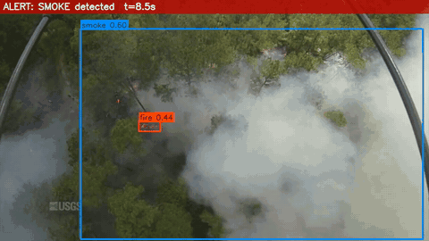

# Wildfire Watch: fire and smoke detection from drone video (YOLO26)

[](https://colab.research.google.com/github/habibis007/wildfire-watch-yolo26/blob/main/notebooks/wildfire_demo.ipynb)



A teaching demo. It takes a drone video, detects **fire** and **smoke** frame by frame with
a YOLO26 model fine-tuned on Roboflow, draws colour-coded boxes, raises an alert only when
detections **persist** across frames, and writes an annotated output video.

## Run the demo

1. Click **Open in Colab** above.
2. *Runtime → Change runtime type → T4 GPU*.
3. Add your Roboflow API key as a Colab Secret named `ROBOFLOW_API_KEY`
   (key icon in the left sidebar; allow notebook access).
4. *Runtime → Run all*. The detection loop over a 30 s clip takes about 5 s even on a laptop
   CPU, so most of the run time is the package install.

No key or no network? The notebook falls back to detections cached from an earlier run,
so the demo still plays.

## What the notebook does

| Step | Code |
|---|---|
| 1. Setup: install `inference`, `supervision`, `opencv-python`; key from Colab Secrets | notebook |
| 2. Frame extraction: `cv2.VideoCapture`, every Nth frame, frame strip | [`frames.py`](src/wildfire/frames.py) |
| 3. Preprocessing: resize, optional CLAHE for hazy smoke | [`preprocess.py`](src/wildfire/preprocess.py) |
| 4. Detection: load the model by its Roboflow ID, run it locally | [`detections.py`](src/wildfire/detections.py) |
| 5. Visualization: fire (red-orange) vs smoke (blue) boxes | [`draw.py`](src/wildfire/draw.py) |
| 6. Alert logic: alert after N consecutive sampled frames, with timestamps | [`alerts.py`](src/wildfire/alerts.py) |
| 7. Output: annotated video, writer always closed, H.264 for browsers | [`writer.py`](src/wildfire/writer.py) |

**Why persistence?** A single-frame detection is often a false positive (sun glare, a red
roof, low cloud). Requiring the same class in 5 sampled frames in a row costs a second or
two of latency but removes most false alarms. A short dropout (under about a second) during
an active event doesn't end it, so one plume produces one alert.

**Why the writer is a context manager:** `cv2.VideoWriter` only writes the file's index
when `release()` is called. If it isn't (an exception, an interrupted cell), the output
is truncated or unplayable.

## Model and data

- **Model:** YOLO26 Nano, fine-tuned from COCO-pretrained weights on Roboflow Train
  (transfer learning). It loads by ID ([`wildfire-watch-yolo26-cicrc/1`](https://universe.roboflow.com/habeebs-workspace-gjewr/wildfire-watch-yolo26-cicrc)); no weights are
  stored in this repo.
- **Data:** about 2,850 images, merged to exactly two classes, `fire` and `smoke`. Resized
  to 640, with light augmentation (horizontal flip, ±20% brightness, 1.5 px blur to mimic
  haze). Sources and licences are listed in [docs/DATASETS.md](docs/DATASETS.md).

Results on held-out images (Roboflow Train, 83 epochs):

| Split | Class | Precision | Recall | mAP50 | mAP50-95 |
|---|---|---|---|---|---|
| valid | all | 0.68 | 0.54 | 0.59 | 0.29 |
| valid | fire | 0.65 | 0.51 | 0.54 | 0.26 |
| valid | smoke | 0.71 | 0.58 | 0.63 | 0.33 |
| test | all | 0.65 | 0.55 | 0.57 | 0.29 |

On the sample clips, the model raises a smoke alert 11 s into clip 01, a few seconds after
smoke drifts into view, and flags small flame patches through the smoke in clip 02. It struggles
with the hazy ground-level clip 03, which is a useful discussion point: it was trained
mostly on aerial and surveillance-camera views.

## Reproduce the dataset and model

```bash
python -m venv .venv && source .venv/bin/activate
pip install -r requirements.txt
echo "ROBOFLOW_API_KEY=your_key_here" > .env   # git-ignored

python scripts/prepare_dataset.py inspect      # check source classes
python scripts/prepare_dataset.py build        # download, remap to fire/smoke, subsample
python scripts/prepare_dataset.py upload       # new project in your workspace
python scripts/train_on_roboflow.py version    # resize 640 + augmentation
python scripts/train_on_roboflow.py train 1 yolo26n   # asks before spending credits
```

If you run out of credits, use
[`notebooks/train_fallback_ultralytics.ipynb`](notebooks/train_fallback_ultralytics.ipynb).
It trains in Colab and uploads the weights back to the same Roboflow version.

Notebooks are generated from [`scripts/build_notebooks.py`](scripts/build_notebooks.py).
Edit that file, then run it again.

## Tests

```bash
pytest
```

The tests cover the alert state machine, frame sampling, and the writer producing a
complete file even when interrupted.

## Credits

- Sample clips: see [samples/CREDITS.md](samples/CREDITS.md).
- Training data: see [docs/DATASETS.md](docs/DATASETS.md).
- Built with [Roboflow Inference](https://github.com/roboflow/inference),
  [Supervision](https://github.com/roboflow/supervision), [OpenCV](https://opencv.org/) and
  [Ultralytics YOLO26](https://docs.ultralytics.com/).

Code is MIT licensed. Sample clips and data keep their own licences.
